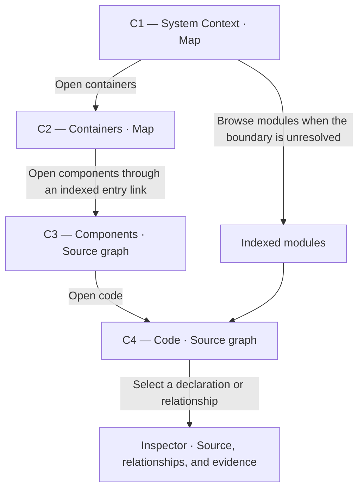
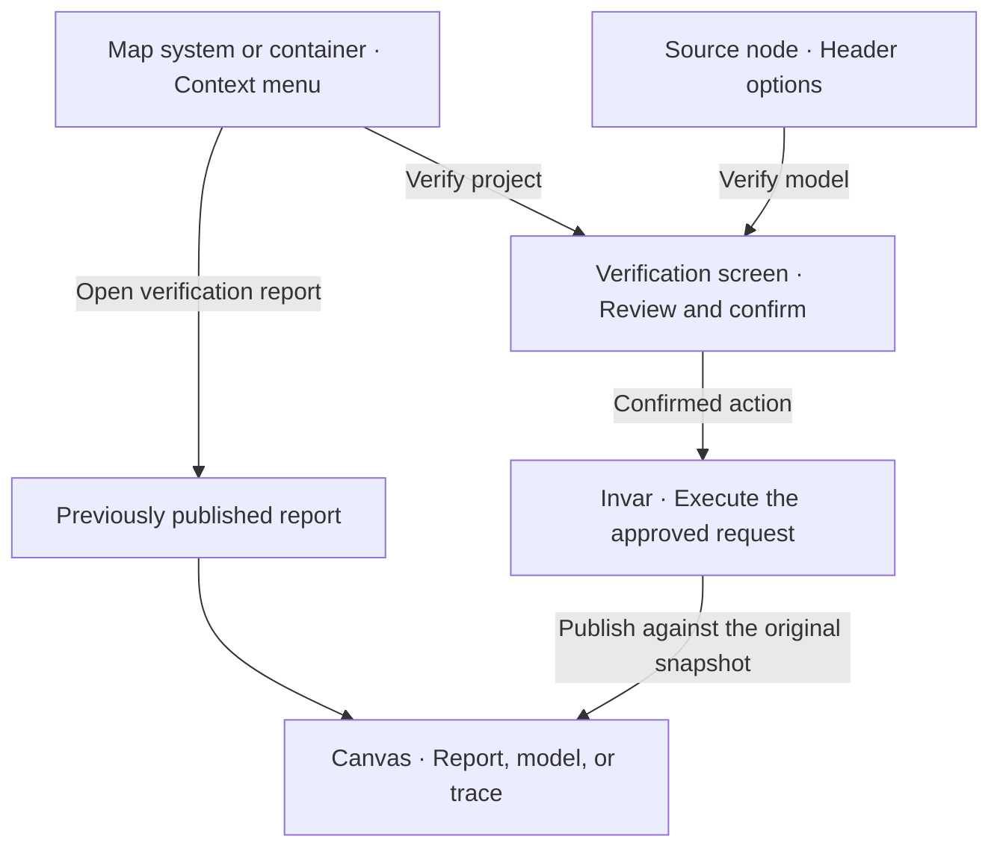
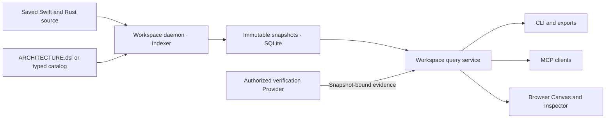

# Architecture Explorer

Architecture Explorer is a local, read-only workspace browser for Swift and Rust. Start with the system and its dependencies, drill into containers and code, and inspect the evidence behind a relationship. The browser, CLI, and MCP server share a workspace daemon and its snapshots.

## Quick start

Use Swift 6.4.1, Python 3, and macOS 27 or later on Apple Silicon. From an Explorer checkout at tag `0.1.0`, build the paired CLI and browser helper, then point them at the repository you want to explore.

```sh
python3 Tools/build.py
.build/debug/architecture index --workspace /path/to/project
.build/debug/architecture explore --workspace /path/to/project --watch \
  --web-helper Apps/ArchitectureExplorerWeb/.build/debug/architecture-web
```

Keep the `explore` command running while using the browser. Add `--no-open` to receive a one-use loopback URL without opening a browser automatically. After rebuilding, restart the workspace daemon before opening the new helper so it recognizes the updated executable. Build only the CLI and libraries with `python3 Tools/build.py --headless`. The browser serves its bundled assets locally. [CLI reference](Documentation/CLI.md) · [Local sessions and trust](Documentation/SECURITY.md)

## Explore a workspace

The browser opens at **System Context**. A root `ARCHITECTURE.dsl` is the authoritative Map model when present. Explorer also supports typed Backstage catalog declarations. If neither supplies a resolved system boundary, use **Browse modules** to start from the indexed implementation. [C4 model inputs](Documentation/C4-CONTEXT-SPEC.md)



| View | What you see |
|---|---|
| **C1 · System Context** | The selected system, people or systems around it, and recorded interactions across boundaries. |
| **C2 · Containers** | Applications, services, and data stores declared for the selected system, with their connections. |
| **C3 · Components** | Design groups and implementation types in the scope resolved from the selected container's entry point. |
| **C4 · Code** | Indexed files, declarations, and relationships. Files can contain their declarations, and supported functions can open a control-flow graph. |

A container's typed source link must resolve to a unique declaration in the same snapshot. Explorer keeps a container with a missing or stale link inspectable on the Map. Select an object, declaration, or edge to see its source or model declaration and its recorded evidence in the Inspector. [Map navigation and source bindings](Documentation/C4-CONTEXT-SPEC.md#from-a-container-to-its-implementation)

| To do this | Use |
|---|---|
| Pan or zoom | Two-finger trackpad scroll or background drag to pan. Pinch or Command-wheel to zoom around the pointer. |
| Find and inspect | Search for symbols or files. Select a node or edge for its details, or switch to **List view** for keyboard navigation. |
| Change the view | Use the Canvas filters and available layouts. Drag the Navigator or Inspector divider to resize its pane. |
| Return to a previous view | Use browser Back. Use **History** to inspect snapshots and **Follow latest** when the Map has a newer snapshot. |
| See indexing and operation diagnostics | Open **Terminal** below the Canvas. |

The interface follows the system Light or Dark appearance. Source nodes show language and declaration kind, such as class, struct, protocol, or function.

## Open verification evidence

Explorer displays the TLA+ and Lean graphs and verification reports supplied by an authorized Provider such as Invar. It retains the original workspace, snapshot, and subject binding so a result can be read alongside the evidence for that version. [Extension API](Documentation/EXTENSIONS-API.md)



- Right-click a Map system or container to open its report or choose **Verify project**. The verification screen opens immediately. **Run verification** confirms a new run when the Provider and project configuration are available.
- Open a source node's options and choose **Verify model**. Select a published result to inspect its checked condition, proof, or counterexample. When only a generated model is available, the Canvas marks it as **Unverified**.
- Whole-project reports show **Specification Verification**, **Implementation Model Verification**, and **Source-to-Model Validation** as distinct assessments. Check the outcome, scope, and source applicability before using evidence from a report.

For the Codex built-in browser, run the same `explore` command with `--codex-browser` from the target conversation. The helper uses that conversation's `CODEX_THREAD_ID`. Open the one-use URL in its browser and have Codex connect the tab with `connect_verification_actions`. **Define verification conditions** then attaches the selected node and its snapshot context to an annotation. Send it in that conversation so Codex can read the pinned request and save the conditions in the target repository. [Browser action contract](Documentation/EXTENSIONS-API.md)

## Import, query, and export

Open a diagram from the workspace menu or drop a file onto the Canvas. Explorer supports profiles of JSON, DOT, Mermaid, PlantUML, GraphML, SCXML, UML XMI, and static SVG. Imported views have their own Canvas sessions. The browser, CLI, and MCP can share their selection, filters, layout, and camera. [Supported diagram syntax and limits](Documentation/CANVAS-FORMATS.md)

```sh
.build/debug/architecture search --workspace /path/to/project --query Counter --format json
.build/debug/architecture graph --workspace /path/to/project --level component --format mermaid
.build/debug/architecture cfg --workspace /path/to/project --symbol ENTITY_ID --format json
.build/debug/architecture export --workspace /path/to/project --level function \
  --format html --out architecture.html
.build/debug/architecture canvas open --workspace /path/to/project --input diagram.mmd
.build/debug/architecture mcp --workspace /path/to/project
```

Use the entity ID returned by search for symbol queries. For paged reads, keep the returned snapshot and cursor together. Graph exports support JSON, Mermaid, SVG, and offline HTML. [CLI commands and query limits](Documentation/CLI.md)

For a directory containing several checkouts, use `explore --workspace /path/to/collection --repository-map /path/to/map.json`. Repository nodes in the Canvas JSON declare their direct checkout directory in `details.checkouts[0]`. This mode reads selected repositories on demand and can show supported Compose service graphs, entry-module composition, and package exports. Refresh the supplied map when the collection's declared membership or relationships change.

## How Explorer works



Default analysis reads saved files. Syntax records can identify possible calls and type references, and a semantic provider can supply stronger evidence within its supported scope. Parse failures retain the last known facts as stale. Set `analysis.maxWorkers` to 1–16 in `architecture.json` to tune indexing concurrency. The default is four workers. [Frontend coverage](Documentation/FRONTENDS.md) · [Performance](Documentation/PERFORMANCE.md)

Official package metadata and local language-server queries require `--trusted-workspace` on the invoking command. Semantic queries also require an explicit provider executable. SwiftPM automatic resolution is disabled for metadata, and Cargo metadata runs offline. [Trust and process boundaries](Documentation/SECURITY.md)

The root Swift package owns the indexer, graph, store, daemon, public client, and MCP server. The separate Web package builds `architecture-web`. Verification tools run through their own Provider. [System design](DESIGN.md) · [Web design](Apps/ArchitectureExplorerWeb/DESIGN.md) · [IPC and MCP](Documentation/PROTOCOL.md)

## Development checks

After a paired build, run the checks for the part you changed.

```sh
scripts/swift-test-timeout.sh 60
python3 Tools/run.py 60 python3 Tools/integration.py
python3 Tools/run.py 60 python3 Tools/web-integration.py
python3 Tools/run.py 60 node --test Tools/canvas.test.cjs Tools/canvas-ui.test.cjs
```

[Verification results](Documentation/VERIFICATION.md) · [Canvas checks](Documentation/CANVAS-VERIFICATION.md) · [Specification](Documentation/SPEC.md) · [Open acceptance work](PROGRESS.md)
